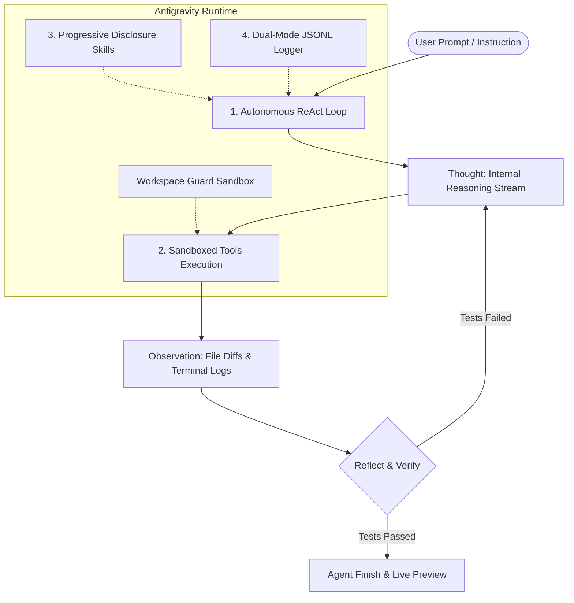

<div align="center">

# ✦ Ashiee AI Agent

### Autonomous AI Pair Programmer & Workspace Development Runtime
*Engineered on the Google Antigravity 2.0 Architecture*

[](https://tinyurl.com/ashiee-ai)
[](https://aryanpalla198.github.io/ashiee-ai-agent/)
[](https://python.org)
[](https://opensource.org/licenses/MIT)
[](#)
[](https://tinyurl.com/ashiee-ai)

<p align="center">
  <a href="#-what-is-ashiee-ai-agent">Overview</a> •
  <a href="#-why-it-is-useful">Why It Is Useful</a> •
  <a href="#-how-it-is-useful">How It Is Useful</a> •
  <a href="#-architectural-pillars">Architecture</a> •
  <a href="#-tools-catalog">Tools Catalog</a> •
  <a href="#-dynamic-project-builder">Project Builder</a> •
  <a href="#-getting-started">Getting Started</a>
</p>

---

</div>

## 📖 What is Ashiee AI Agent?

**Ashiee AI Agent** is an open-source, autonomous AI pair-programming assistant and development runtime built to mirror and extend the **Google Antigravity 2.0** architecture.

Unlike simple LLM chat wrappers that only produce passive code snippets in markdown, Ashiee acts as an **active, autonomous software engineer inside your local workspace**. She reasons across multi-step ReAct loops, makes surgical and deterministic file modifications, executes sandboxed terminal commands, verifies implementations with automated test suites, and hosts live web applications on local development ports—all observable in real time through an obsidian-themed **Desktop Canvas Studio**.

---

## 💡 Why It Is Useful

Modern software engineering involves far more than generating syntax; it requires:
1. **Understanding Workspace Context**: Navigating directory trees, inspecting existing modules, and respecting project rules.
2. **Deterministic File Surgery**: Making precision edits without destructive overwrites or losing comments.
3. **Closing the Execution Loop**: Running builds, executing unit tests (`pytest`), observing compiler errors, and self-correcting autonomously.
4. **Offline Resilience with Sub-15ms Speed**: Operating at lightning speed without waiting seconds for external cloud delays.
5. **Progressive Skill Loading**: Keeping LLM context small and focused by indexing skills as lightweight headers and loading complete runbooks only when activated.

**Ashiee solves these challenges** by providing an end-to-end autonomous pair-programming runtime that turns conversational requirements into fully constructed, tested, and running software.

---

## ⚙️ How It Is Useful

| Workflow | How Ashiee Handles It |
| :--- | :--- |
| **Autonomous App Construction** | Prompt Ashiee to *"build a calculator"*, *"build a snake game"*, or *"build a customer userlogin arya name"*. She automatically writes the backend Python code, frontend HTML5/CSS3/JS, test suites, and launches the live app on port 5000. |
| **Surgical Code Modifications** | Uses `replace_file_content` with exact text matching, line numbers, and unified diff output (`diff_block_start`), preventing truncation and preserving documentation integrity. |
| **Automated Verification** | Executes `pytest` test suites in a sandboxed PTY subprocess, parses failure stack traces, and self-corrects until tests pass 100% green. |
| **Dynamic Multi-App Serving** | Built-in FastAPI server serves whatever application was constructed (`/calculator`, `/todo`, `/snake`, `/login`, `/weather`, `/portfolio`) directly to an interactive live preview canvas. |
| **Collaborative Antigravity Bridge** | Synchronizes memory, context, and 11 progressive skills with Google Antigravity across workspace boundaries. |

---

## 🏛 Architectural Pillars

Ashiee is architected on four fundamental pillars:



### 1. Autonomous ReAct Reflection Loop
Ashiee operates on a continuous **Reason → Act → Observe → Reflect** cycle:
- **Reason**: Emits real-time reasoning deltas to the Thoughts feed in the UI.
- **Act**: Emits structured tool calls with strongly-typed arguments.
- **Observe**: Receives tool output, execution exit codes, and unified diffs.
- **Reflect**: Checks output against expected criteria and iterates autonomously.

### 2. Progressive Disclosure Skills System (`SKILL.md`)
Skills are discovered dynamically across:
1. Workspace root: `.agents/skills/`
2. User global configuration: `~/.ashiee/skills/`
3. Antigravity shared skills: `.gemini/antigravity/builtin/skills/` and plugins.
System prompts remain ultra-compact by only loading skill YAML frontmatter headers; full instructions are loaded on-demand via `load_skill`.

### 3. Dual-Mode JSONL Transcripts
Every interaction is recorded with cryptographic timestamps:
- **`transcript.jsonl`**: Compact summary for fast navigation and search.
- **`transcript_full.jsonl`**: Full audit log preserving complete token streams, reasoning chains, tool parameters, and outputs.

### 4. Sandboxed Terminal & Workspace Guard
Commands and file operations are strictly guarded:
- Directory traversal attacks (`../`) are blocked outside the active workspace.
- Command filtering blocks destructive disk commands (`rm -rf /`, `format`, etc.).
- Subprocess timeouts prevent hung builds or infinite loops.

---

## 🛠 Tools Catalog

Ashiee comes equipped with a comprehensive suite of registered sandboxed tools:

| Tool Name | Parameters | Purpose |
| :--- | :--- | :--- |
| **`write_to_file`** | `path`, `content`, `overwrite` | Safely creates or updates code files with directory creation and sandbox boundary checks. |
| **`replace_file_content`** | `path`, `target_content`, `replacement_content`, `start_line`, `end_line` | Performs surgical, non-destructive file edits and produces unified diffs. |
| **`view_file`** | `path`, `start_line`, `end_line` | Inspects slices or complete contents of repository files with line numbering. |
| **`run_command`** | `command`, `cwd`, `timeout`, `background` | Executes sandboxed terminal commands (PowerShell / Bash) with real-time streaming and background daemon support. |
| **`search_code`** | `pattern`, `path`, `regex` | Fast ripgrep-style regex search across codebase files. |
| **`find_files`** | `pattern`, `path` | Glob-based search to map file hierarchies across directories. |
| **`load_skill`** | `name` | Dynamically activates progressive skills runbooks into the agent's context. |
| **`list_skills`** | *None* | Discovers all available skills across workspace and global configurations. |
| **`create_artifact`** | `name`, `content`, `type` | Publishes persistent markdown reports, architecture diagrams, and interactive widgets. |
| **`invoke_subagent`** | `role`, `task`, `model` | Delegates specialized subtasks to concurrent child agents. |
| **`manage_subagents`** | `action`, `subagent_id` | Monitors lifecycle states or terminates running subagents. |

---

## 🚀 Dynamic Project Builder

Ashiee features a built-in **Dynamic Project Builder Engine** ([`ashiee/core/project_builder.py`](ashiee/core/project_builder.py)). When asked to build an application, she autonomously synthesizes all required files, tests, and web interfaces:

- **Customer Login & Authentication**: PBKDF2 HMAC-SHA256 password salting (100,000 iterations), 32-byte cryptographic session tokens, and obsidian login portal.
- **Interactive Neumorphic Calculator**: Python AST-based safe arithmetic expression evaluator and dark-mode glassmorphic web UI.
- **Task Orchestrator (Todo App)**: Persistent task tracking with filter tabs and REST backend.
- **Cyberpunk Neon Snake Game**: 60fps HTML5 Canvas arcade game with keyboard navigation and glowing neon aesthetics.
- **Weather Telemetry Dashboard**: Atmospheric metrics cards featuring humidity, pressure, and UV index.
- **Developer Portfolio**: Responsive personal brand landing page with skills badges and project cards.
- **Custom Utility Modules**: Specific requested files (such as `string_helpers.py` with `slugify`, `title_case`, `truncate_words`) generated with complete unit tests.

---

## 🖥 Live Desktop Canvas UI

Ashiee includes an interactive, obsidian-styled web canvas running on **FastAPI + WebSockets**:

```
┌─────────────────┬──────────────────────────────────────────┬─────────────────────────────┐
│    SIDEBAR      │            MAIN CHAT CANVAS              │       AUXILIARY PANE        │
│ ✦ Ashiee Studio │                                          │ [Thoughts] [Terminal] [Diff]│
│                 │ [User] "build a calculator"              │ [Artifacts] [Preview] [Sync]│
│ 📁 Workspace    │                                          ├─────────────────────────────┤
│ ⚙ Model Status  │ [Ashiee] ✦ Constructing Calculator...    │ Live Application Preview:   │
│ 📦 Constructed  │          Writing calculator.py           │ ┌─────────────────────────┐ │
│    Projects     │          Writing calculator.html         │ │ ✦ Neumorphic Calculator │ │
│    • Port 5000  │          Executing pytest tests/         │ │ [ 12 + 4 * 2 = 20     ] │ │
│                 │                                          │ │ [ 7 ] [ 8 ] [ 9 ] [ + ] │ │
│ 🛡 Sandbox Guard│ 👉 Live: http://127.0.0.1:5000           │ └─────────────────────────┘ │
└─────────────────┴──────────────────────────────────────────┴─────────────────────────────┘
```

- **Obsidian Dark Aesthetic**: `#0B0D14` background with Google Blue (`#4285F4`) and Purple pulse accents.
- **Real-Time Token Streaming**: Text flows word-by-word with an active pulsing streaming cursor.
- **Live Preview Tab**: Built-in iframe at `http://127.0.0.1:5000` to interact with constructed web projects immediately.
- **Collab Bridge Tab**: Displays real-time Antigravity synchronization telemetry, shared skills, and latency metrics.

---

## 📦 Project Structure

```text
ashiee-ai-agent/
├── .github/
│   └── workflows/
│       └── ci.yml                 # GitHub Actions automated multi-OS CI
├── ashiee/                        # Core Python Package
│   ├── config.py                  # Environment & Provider Configuration
│   ├── core/
│   │   ├── agent.py               # Main AshieeAgent ReAct Engine & Streaming
│   │   ├── antigravity_bridge.py  # Antigravity 2.0 Collaboration Hub
│   │   ├── context.py             # Context Assembler & Rules Crawler
│   │   ├── llm.py                 # Multi-Provider Gateway (Gemini, Mock, Cloud)
│   │   ├── project_builder.py     # Dynamic Autonomous App & Code Builder
│   │   ├── subagent.py            # Subagent Dispatcher & Worker Pool
│   │   └── transcript.py          # Dual-Mode JSONL Audit Logger
│   ├── server/
│   │   ├── app.py                 # FastAPI & WebSocket Canvas Server
│   │   └── static/
│   │       ├── app.js             # Real-time WebSocket Client & Streaming
│   │       ├── index.html         # Studio Canvas Interface
│   │       └── styles.css         # Obsidian Design System
│   ├── skills/
│   │   └── manager.py             # Progressive Disclosure Skills Engine
│   └── tools/                     # Registered Sandboxed Tools
│       ├── artifact_tool.py       # Structured Artifacts Generator
│       ├── base.py                # BaseTool & ToolRegistry
│       ├── file_ops.py            # Surgical File Operations
│       ├── search.py              # Code Search & File Finding
│       ├── skills_tool.py         # On-Demand Skill Loading
│       ├── subagent_tool.py       # Subagent Orchestration Tools
│       └── terminal.py            # Sandboxed PTY Command Execution
├── builtin_skills/                # Progressive Skills Library
│   ├── code-reviewer/             # Architectural Code Review Runbook
│   └── test-generator/            # Pytest Test Generation Runbook
├── tests/                         # Automated Pytest Suite
│   ├── test_auth.py               # Cryptographic Auth Tests
│   ├── test_calculator.py         # Calculator Math Engine Tests
│   ├── test_core.py               # ReAct Loop & Tools Tests
│   └── test_string_helpers.py     # String Transformation Tests
├── .gitignore                     # Git Exclusion Rules
├── LICENSE                        # MIT License
├── pyproject.toml                 # Modern PEP 621 Build Configuration
├── requirements.txt               # Locked Dependencies
├── run_ashiee.py                  # Unified CLI Entry Point
├── run_ashiee.bat                 # Windows Double-Click Launcher
├── server.py                      # Multi-App Live Development Server (Port 5000)
└── setup.py                       # Packaging Configuration
```

---

## ⚡ Getting Started

### Prerequisites
- Python 3.10 or higher (Python 3.12 / 3.13 recommended)
- Windows, macOS, or Linux

### 1. Installation
Clone the repository and install in editable mode:

```bash
git clone https://github.com/aryanpalla198/ashiee-ai-agent.git
cd ashiee-ai-agent
pip install -e .
```

### 2. Launch the Desktop Canvas Studio
Start the interactive pair-programming canvas on port 8000:

```bash
python run_ashiee.py serve --port 8000
```

Open your browser and navigate to:
👉 **[http://127.0.0.1:8000](http://127.0.0.1:8000)**

### 3. CLI Commands
Ashiee also provides direct terminal workflows:

```bash
# Start an interactive CLI chat session
python run_ashiee.py chat

# Inspect workspace status and tool registries
python run_ashiee.py inspect
```

### 4. Running the Test Suite
Verify that all 14 unit tests pass 100% green:

```bash
pytest tests/ -v
```

---

## 🔑 Cloud Model Configuration (Optional)

Ashiee runs out-of-the-box with full offline autonomous synthesis. To connect cloud models:
1. Create a `.env` file in the repository root:
   ```env
   GEMINI_API_KEY=your_gemini_api_key_here
   MODEL_NAME=gemini-2.5-flash
   ```
2. Or click the **Settings ⚙** icon in the Studio Canvas sidebar and paste your Gemini API key.

---

## 📄 License

This project is licensed under the [MIT License](LICENSE) — free for personal, educational, and commercial use.

---

<div align="center">
  <b>Built with ✦ by Aryan Palla</b><br>
  <i>Powered by Google Antigravity Architecture</i>
</div>
